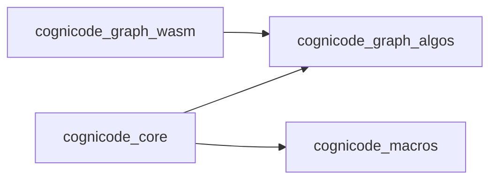

# SDK architecture

Architecture of the four library crates of the CogniCode SDK, as classified by
[`SDK_SURFACES.json`](SDK_SURFACES.json). Every statement starts with a
provenance label:

- `[observed]` — reported by a tool at the time of the last regeneration, and
  compared with the tool's current output by `scripts/ci/test_sdk_architecture.py`.
- `[inferred]` — a conclusion drawn from observed facts; it can be wrong.
- `[curated]` — written by a person; no tool vouches for it.

## Scope

- [curated] Covers the `library` crates of `SDK_SURFACES.json`: `cognicode-core`, `cognicode-graph-algos`, `cognicode-graph-wasm`, `cognicode-macros`.
- [curated] `cognicode-explorer` and the application crates are out of scope until the Explorer decision of TASK-177 is lifted; coverage of the whole product is therefore partial.
- [curated] Only the crate root (`src/lib.rs`) of each library is inspected; symbols declared in other modules are not listed.

## Dependency graph



- [observed] The diagram lines are printed by `python3 -I scripts/ci/sdk_dependency_edges.py` from the normal dependencies `cargo metadata` reports between the libraries; the test compares them with the block above.
- [curated] The `graph LR` header and the choice of drawing only library crates are written by hand.
- [inferred] `cognicode-graph-algos` and `cognicode-macros` have no dependency on another library, so they can be published first.

## cognicode-core

- [observed] `cognicode inspect` reports 0 symbols declared in `crates/cognicode-core/src/lib.rs`.
- [inferred] The crate root only re-exports modules; the public API lives below it and is not covered here.

## cognicode-graph-algos

- [observed] `cognicode inspect` reports 0 symbols declared in `crates/cognicode-graph-algos/src/lib.rs`.
- [inferred] The crate root only re-exports modules; the algorithms live below it and are not covered here.

## cognicode-graph-wasm

- [observed] `crates/cognicode-graph-wasm/src/lib.rs` declares the functions `pagerank` (function), `god_nodes` (function), `communities` (function), `community_god_nodes` (function), `surprising_connections` (function).
- [observed] It also declares `build_id_index` (function), `build_out_neighbors_from_edges` (function), `condensation` (function), `transitive_reduction` (function).
- [observed] And `feedback_arc_set` (function), `all_simple_paths` (function), `cluster_components` (function).
- [inferred] The functions mirror graph-algos analyses (ranking, communities, cycles, paths) for use from WebAssembly.

## cognicode-macros

- [observed] `crates/cognicode-macros/src/lib.rs` declares the functions `derive_newtype` (function), `aix_tool` (function), `declare_rule` (function), `cogni_rule` (function), `parse` (function).
- [observed] `parse` is declared twice in the crate root, at different lines.
- [inferred] The crate provides procedural macros for newtypes, tools and rules.

## Applications

- [curated] These crates ship binaries, not libraries; they are listed only to show which SDK libraries they build on. Their symbols are not documented here, and `cognicode-explorer` stays out until the TASK-177 decision is lifted.
- [observed] `cognicode-cli` depends on `cognicode-core`
- [observed] `cognicode-mcp` depends on `cognicode-core`
- [observed] `cognicode-sandbox` depends on `cognicode-core`
- [observed] `cognicode-cli` declares the root modules `cli`, `identity`, `lifecycle`, `presenter`, `skills`
- [observed] `cognicode-mcp` declares the root modules `auth`, `cancellation`, `capabilities`, `exposure`, `input_contracts`, `link_trace`, `output_contracts`, `parameter_aliases`, `presenter_bridge`, `rmcp_adapter`, `robustness`, `status`, `surface_tools`, `tool_response`
- [observed] `cognicode-sandbox` has no `src/lib.rs`
- [curated] The root modules are what `src/lib.rs` declares with `pub mod`; they are not an SDK API, carry no semver promise and their contents are not listed.
- [inferred] No application depends on `cognicode-graph-algos`, `cognicode-macros` or `cognicode-graph-wasm` directly; the graph algorithms reach them through `cognicode-core`.

## Evidence ledger

- [observed] `cognicode-graph-wasm`: recorded with the cognicode-diagrams flow on 2026-11-08, 2 structured queries (`cognicode inspect --format json` on `src/lib.rs`, engine `cognicode-cli 0.102.1`) and 12 entity claims, one per function; `evidence.py --check` reports all as corroborated.
- [observed] `cognicode-macros`: recorded the same way on 2026-11-08, 1 structured query and 6 entity claims, one per function declaration (`parse` is declared twice); `evidence.py --check` reports all as corroborated.
- [curated] The ledger and the atlas live outside the repository under `~/.cognicode-diagrams/` and are not versioned, so the contract cannot read them; it only checks that this section names the recording commands and that each crate's claim count equals its documented function declarations.
- [curated] Coverage is partial: only `cognicode-graph-wasm` and `cognicode-macros` have ledger entries; the other crates were documented from `cognicode inspect` and `cargo metadata` without recording them.

## Regenerate

Run from the repository root with the installed `cognicode` CLI:

```bash
cognicode inspect --file crates/cognicode-core/src/lib.rs
cognicode inspect --file crates/cognicode-graph-algos/src/lib.rs
cognicode inspect --file crates/cognicode-graph-wasm/src/lib.rs
cognicode inspect --file crates/cognicode-macros/src/lib.rs
cargo metadata --no-deps --offline --format-version 1
python3 -I scripts/ci/sdk_dependency_edges.py
python3 -I scripts/ci/test_sdk_architecture.py
```

To record the same observations in the external ledger (skill `cognicode-diagrams`, run from its directory; each payload is JSON facts, the tool stamps the ids):

```bash illustrative
python3 -I scripts/record.py query --repo <repo-root> --payload query.json
python3 -I scripts/record.py claim --repo <repo-root> --payload claim.json
python3 -I scripts/evidence.py --repo <repo-root> --check
python3 scripts/atlas.py sync --repo <repo-root>
```

- [curated] The last command fails when an observed list or a diagram edge no longer matches the tools' output.
