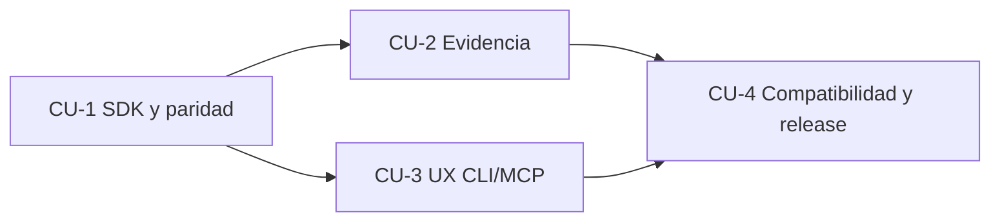

# CU — Roadmap de entrega de valor para consumidores (propuesta de subprograma Post-PRF)

**Autoridad:** `docs/roadmap/ROADMAP.md` (única agenda). CU se incorpora exclusivamente mediante un puntero nuevo y un bloque secuencial propio; no reemplaza B1–B6, PR-G2/C8-R ni PRODUCT-1.0. **Estado inicial: PROPOSED/NOT_STARTED**. Cada CU debe entregar una capacidad real; un documento no es una release.

## Resultado final

Un agente puede usar CogniCode indistintamente por biblioteca Rust, CLI y MCP; recibe cobertura, errores, precisión, procedencia y siguientes acciones coherentes. CogniCode Guard consume ese resultado y conserva exclusivamente su lógica de admisión y política. Ninguna capacidad de lectura adquiere permiso de escribir o bloquear. Los resultados se pueden verificar por snapshot y se redistribuyen mediante artefactos instalables.

## Contratos transversales

1. Usar `application::analysis_basis`, `domain::findings`, `evidence_kernel`, `interface::catalog`, `interface::symbol_identity`, `impact` e `incremental` existentes; no crear motor/sistema de catálogo paralelo. Nuevo tipo/puerto solo después de detectar un seam realmente necesario en el código.
2. FP: `observe -> validate -> decide -> execute-effects -> report`. Tipos algebraicos cerrados para incertidumbre, cobertura, permiso, capacidad, origen y resultado. Funciones puras en dominio, shell impuro acotado a adaptadores/raíces de composición. Ningún `bool` genérico representa varios estados.
3. Eliminar `unwrap`/panic en entradas del consumidor; ningún valor por defecto convierte `Partial|Unknown|Unsupported|Failed` en `Complete` o «sin impacto». `NonEmpty` para listas de gaps obligatorias; sum types que distinguen `Advisory` de `Verified`.
4. API estable y evolucionable, sin depender del formato de salida de CLI para SDK ni compartir servicios internos con handlers MCP. Preservar `assurance-evidence/v1` y herramientas existentes, o publicar deprecación explícita y N−1 tests.
5. Test inner loop barato por cambio, integración completa antes de cortar release y test sobre los mismos bytes del artefacto publicado; no añadir CI duplicada. Medir coste de validación, no imponer baterías irrelevantes en cada commit.
6. Seguridad: core sin red y sin collector requerido, stdout MCP estrictamente protocolo, permisos `read|write|execute|network` independientes; paths canónicos/aislamiento; no exponer refactor mutante por un tool de lectura.
7. Documentar progreso como estados verificables `NOT_STARTED|IN_PROGRESS|PAUSED|DONE`; `DONE` exige refs remotos, release y evidencia. No atribuir a un agente facultad para aprobar sign-offs humanos.

## Bloques largos, terminados en release e integración remota

| Bloque | Capacidad observable entregada | Prioridad | Depende de | Modo de cierre |
|---|---|---|---|---|
| **CU-1 — SDK de consumo fiable** | Un consumidor Rust recibe el mismo `AnalysisOutcome` que CLI/MCP, con error/coverage/capabilities tipados; demo mínima de Guard compila | P0 | Estado local reconciliado, `B2/B3` ya entregados | PR→merge-gate→main→full/integration→RC→release→descarga y smoke |
| **CU-2 — Evidencia con autoridad correcta** | Detección→fact/evidence→verificación→adaptador Guard sin falso bloqueo | P0 | CU-1 | Igual + AAT negativa de evidencia y snapshot |
| **CU-3 — Experiencia agent-first compacta** | `inspect`/`explain`/affordances consumibles, contexto paginado, errores y siguiente paso coherente en CLI/MCP | P1 | CU-1; usa CU-2 cuando requiere evidencia | Igual + E2E agente sin leer el código de la tool |
| **CU-4 — Eficiencia y compatibilidad cross-repo** | Análisis incremental/reutilización honesta, negociación de versiones y matriz Guard↔CogniCode reproducible; consumidor instalado | P1 | CU-1..3 | Igual + release de producto, inventario completo y smoke N−1 |

### CU-1 — SDK de consumo fiable (3–5 WUs amplias)

**Dolor:** `guard-cognicode` usa `AnalysisService + CallGraphAnalyzer`, pero no hay un punto estable suficientemente pequeño que reúna base/cobertura, grafo, errores, identidad y capacidades de producto. Guard prepara diferentes planes CLI/MCP.

**TODO de implementación**

- [x] CU-1.1 **Caracterizar contratos existentes.** Comparar `AnalysisBasis/Analyze/AnalysisOutcome`, DTOs publicados, tool catalog y coste de dependencia. Elegir mínima ampliación in-place de `cognicode-core`; **no crear crate SDK nuevo** salvo evidencia de dependencia innecesaria real.
  - **Hecho 2026-10-16 (verificado):** `Analyze` existía desde B2.W1 sin NI UNA impl de producción; `CapabilityRequest` no existía; CLI y MCP orquestaban `AnalysisService` a mano. Ampliación in-place elegida: `application/consumer_analysis.rs` + `application/services/analyze.rs` en `cognicode-core`, sin crate nuevo.
- [x] CU-1.2 **Facade tipada y estable.** Resolver `CapabilityRequest` → `CapabilityPlan` con `Complete/Partial/Unsupported` y precondiciones claras. Construir grafo mediante el servicio actual y exponer `GraphSnapshot`/query sin importar infraestructura. Mantener `AnalysisScope`/`SymbolId` y precisión.
  - **Hecho:** `ConsumerAnalysisFacade` (resolve pura + analyze vía `&dyn Analyze` + `provider_version()`); `CapabilityRequest::for_graph/for_complexity` smart ctors; `ServiceAnalyzer` impl `Analyze` sobre `AnalysisService` real. Commit `036d266a`. Tests: `cu1_w2_facade_contract` (6) + `cu1_w2_service_analyzer_contract` (4).
- [x] CU-1.3 **CLI/MCP como presentadores.** Un caso de uso común implementa análisis; CLI y MCP traducen entradas/salidas al contrato existente. N−1 no cambia sin migración. `tools/list`, salida JSON y catálogo describen prestaciones **reales**.
  - **Hecho:** `graph full` CLI ejecuta vía `ServiceAnalyzer` + presenter bridge (`interface/cli/presenter_bridge.rs`); orquestación manual eliminada; stderr "Skipped:" preservado. Paridad N−1 probada: `t1_5_4k_graph_full_snapshot` (3), `cli_exit_code_propagation` (26), `prf_cli_01_uat` (16) verdes sin edits. Commit `8905973e`.
- [x] CU-1.4 **Prueba del consumidor Guard** en copia efímera: Rust SDK vs CLI vs MCP sobre fixture con ciclos, homónimos y cobertura parcial. Identificar explícitamente cualquier cambio que debe hacerse en Guard, separarlo en PR externo.
  - **Hecho (UAT efímero retirado tras promover):** fixture con main+compute+homónimo `helper` en alpha.rs/beta.rs. HALLAZGO REAL: CLI/SDK decían `Complete` mientras MCP decía `partial` sobre el MISMO workspace (Cargo.toml saltado). Root cause: `ServiceAnalyzer.graph_full` no consultaba `get_last_build_report()`. FIX: `BuildStatus::Partial{skipped}` → `AnalysisOutcome::partial` con gaps = ficheros saltados (commits `7f06d7f2`+`566c4ece`). Promovido a regresión en `cu1_w2_service_analyzer_contract` (ley de paridad: gap nombra el fichero saltado). Re-run 3 canales: CLI `partial`/5 símb/1 dep/skip Cargo.toml = SDK `Partial`/5/1/1 gap = MCP `partial`/5/1/Cargo.toml. Cambios en Guard: NINGUNO requerido (la facade cubre lo que Guard usa hoy de `AnalysisService`+`CallGraphAnalyzer`; migración de Guard es CU-2, no parte de CU-1).
- [x] CU-1.5 **Cerrar entrega.** Revisión de documentación, uso con `cognicode --help`, binarios reales, merge, release. Resolver si sigue roto el enlace a la especificación B1–B6 sin crear docs históricos ficticios.
  - **Hecho:** fmt 0 difs, clippy `-D warnings` 0, workspace 6578 passed (1 flake TCP preexistente cr07 bajo carga paralela, 3/3 serial verde), gate de cobertura bumped 65→68 con las 3 suites CU-1 como anchors.
  - **Merge-gate VERDE (2026-10-17):** `[PipelineK] Finished: success`, 58 etapas, 0 fallos, sobre `cu1-version-law` = `origin/main` (`4996246e`) + `2fedc9fb` (ley de versión del provider derivada del workspace, SPEC-CU-001.6). Ese fix evita que el próximo bump de versión rompa de nuevo el test.
  - **Falso rojo preexistente, NO de CU-1 (cuarentena documentada, no parcheada):** `scripts/ci/test_build_isolation_check.py` fallaba en `origin/main@4996246e` limpio. Root cause medido: el fixture compara rutas de `ps` contra el cwd, y en esta máquina `/home/rubentxu` es symlink de `/var/home/rubentxu`, así que la comparación textual falla aunque el directorio sea el mismo. Con `TMPDIR=/var/home/rubentxu/.jcode/scratch` (ruta ya normalizada) el gate pasa. El diff de CU-1 no toca `scripts/ci/`. **Deuda:** normalizar el path del fixture con `os.path.realpath` en un PR propio, para que el gate sea fiable sin variables de entorno.
  - **Integración remota:** SDK (`consumer_analysis.rs`, `services/analyze.rs`), presenter bridges y las 3 suites permanentes están en `main` vía #354/#356. PR #356 MERGED (`2fedc9fb`). Ver cierre de release abajo.

**Aceptación mínima:** `AnalysisOutcome` coherente; no `Complete` si falta grafo; mismo conjunto de símbolos/resultados y la misma cobertura por tres canales; un consumer construye contra la revisión fijada. **Pruebas:** 2 tests permanentes (ADTs + contrato de proyección); UAT-CU-1 temporal; AAT-CU-1 temporal, ver `acceptance/SCENARIOS.md`.

**Referencias:** `SPEC-CU-001`, `SPEC-CU-002`, `ADR-CU-001`, `ADR-CU-002`; `odd/tasks/b2-shared-analysis-capability-contracts.md`, `odd/tasks/b3-agent-code-understanding.md`, `docs/adr/ADR-029-callgraph-projection-port-seam.md`.

**Equipos paralelos:** Team A dominio+facade; Team B catálogo/schemas (solo después de fijar tipos, sin editar core de A); Team C caracterización Guard y smoke de consumidor (fixtures propios, no modificar A). Integrador único controla los commits y releases.

### CU-2 — Evidencia con autoridad correcta (4–5 WUs amplias)

**Dolor:** Guard emite `Ungrounded` y fabrica metadata de admisión al traducir reglas; su modelo de `AdmittedFinding` no equivale a `FindingVerifier` upstream. Sin un puente estable, la política corre riesgo de promover diagnóstico a veredicto.

**TODO de implementación**

- [x] CU-2.1 **Trazar pipeline upstream ya existente**: `ArchitectureViolation`, `ProducedEvidence`, `EvidenceBinding`, `FindingAssembler`, `FindingVerifier`, `AnalysisScope`. Identificar dónde puede obtenerse evidencia canónica REAL y dónde solo existe indicio.
  - **Hecho 2026-10-17 (PR #365, commit `1945b4f5`):** Trazado del pipeline en `docs/roadmap/consumer-contracts/traceability/CU-2-1-PIPELINE-TRACE.md`. Diagrama del flujo `Detector → FindingAssembler → FindingVerifier → FindingGate (gateable verificado)` y del flujo paralelo consultivo `ArchitectureViolation → ArchitectureGroundingBridge → ProducedEvidence`. Type map con autoridad explícita (CogniCode técnica vs Guard admisión). 4 tests negativos AAT-CU-2 ya cubiertos en `verifier.rs`; 2 restantes (signature arbitraria, detector no admitido) son territorio Guard (CU-2.3). Sin código nuevo.
- [x] CU-2.2 **Publicar lectura verificable sin mutación**: una proyección tipada que conserva `SnapshotId`, localización/rango, grado/precisión, `EvidenceId` y causas. `Unknown/Unsupported` por falta de facts, no valores sintéticos. Mantener feature flags del kernel.
  - **Hecho 2026-10-17 (PR #367, commit `050db27f`):** Nuevo módulo `domain::findings::projection` con ADT `FindingProjection` (Verified | Advisory | Inconclusive), `ProjectionError` (Unsupported | Inconclusive | Failed) y `TypedEvidenceHandle` que vincula cada `EvidenceId` con su `SnapshotId` por construcción. Discriminación total: nunca un `Verified` vacío, nunca conversión a `[]` o `Clean`. 6 tests permanentes en `cu2_w2_finding_projection`. No toca el envelope `assurance-evidence/v1` (wire format con consumer Kotlin) ni el kernel de findings.
- [x] CU-2.3 **Contrato de transferencia a Guard**: definir `VerifiedFinding | AdvisoryObservation | Inconclusive` y un adaptador que convierta sin firmar nada. Guard sigue dueño de `PolicyDecision`, `RuleAdmission`, firmas y recibos; pruebas negativas impiden tratar `signature.len()>0` como autoridad.
  - **Hecho 2026-10-17 (PR #368, merge `0d51e1a1`):** Nuevo módulo `domain::findings::guard_transfer` con ADT `GuardObservation` (Verifiable | Advisory | Inconclusive | Unsupported | Failed) y única función `to_guard_observation(&Result<FindingProjection, ProjectionError>) -> GuardObservation`. El transfer es passthrough: no firma, no fabrica `admitted_at`, no inventa `AdmitterRole::HumanPromoter` (test `adversarial_signature_bytes_never_carry_into_observation` pinea por debug-format que esos nombres no aparecen en la salida). 8 tests permanentes en `cu2_w3_guard_transfer`. `core_gate_coverage_contract` bumped 68 -> 69 con `cu2_w3_guard_transfer` como nuevo anchor.
- [x] CU-2.4 **Consumidor vivo en aislamiento**: repetir caso real Rust con hallazgo técnico y decisión Guard sobre copia de trabajo; validar cambios de snapshot, evidencia inexistente y precisión heurística.
  - **Hecho 2026-10-17 (PR #371, merge `009bccc8`):** `crates/cognicode-core/tests/cu2_w4_live_consumer.rs` con 7 tests que ejercitan el seam completo `project_finding` + `to_guard_observation` sobre Findings shaped como los que un detector real emitiría. Helper `pipeline(finding, snapshot) -> GuardObservation` une proyección y transfer. Cubre: working copy change (`Unsupported` no `Verifiable` stale), evidence id forjado (passthrough fiel, no promotion), precisión heurística (D→`Inconclusive`, C→`Advisory`, A|B→`Verifiable`), causal chain preservada (Grounded/Ungrounded visibles), total chain (los 5 discriminantes alcanzables). UAT efímero en `/tmp/cognicode-cu24-uat/run_uat.sh` (fixture Rust real con homónimos alpha.rs/beta.rs + `cognicode graph full` + `cognicode analyze` + re-parse tras modificación) ejecutado PASS; evidencia en `/tmp/cognicode-cu24-uat/evidence.txt`. `core_gate_coverage_contract` bumped 69 → 70 con `cu2_w4_live_consumer` como nuevo anchor.
- [x] CU-2.5 **Release**: integrar y publicar el core y binarios afectados, registrar N−1 y un ejemplo de consumidor instalable.
  - **Hecho 2026-10-17 (PR #374, release `v0.101.21`):** gate verde en `754bb9f6` (3 rounds: golden y snapshot del corte
  reparados en la ventana), squash `755e97a6`, tag anotado, RC de 32 etapas verdes desde el commit taggeado, lane de
  publicación con 8 assets verificados (sumas, asset-set, tag-coherence, instalación y smoke JSON reales). N−1 Guard
  (`v0.101.10`, ADR-CU-001) sin cambios; verificación cross-repo queda como estado externo para CU-4.3. Veredicto:
  `production-ready/veredictos/2026-10-17-cu2-release-v0.101.21.md`.

**Aceptación:** misma evidencia causa mismo resultado; evidence-id inexistente o snapshot distinto jamás gatea; observaciones sin grounding son informativas; la firma de autorización debe verificarse en Guard, no en CogniCode. **Tests permanentes:** dos leyes de verificación (scope/evidencia); UAT-CU-2 y AAT-CU-2 efímeros.

**Referencias:** `SPEC-CU-003`, `ADR-CU-003`, `odd/tasks/b4-impact-architecture-quality.md`, `docs/roadmap/adr/ADR-010-KNOWLEDGE-EVIDENCE-NAMESPACE.md`.

**Equipos paralelos:** A seam evidence/read-side; B modelo de mapeo / semántica pura y tabla de conformidad; C integración Guard/adversarial temporal (repo separado). No crear dos tipos duplicados sin conversiones explícitas.

### CU-3 — Experiencia agent-first compacta (3–4 WUs amplias)

**Dolor:** herramientas y prompts entregan información excesiva o exigen conocer comandos y precondiciones. CogniCode ya cuenta con `ToolDescriptor`, `route_intent`, `inspect`, `impact`, outputs con schema; hay que llevarlos al consumo real.

**TODO de implementación**

- [ ] CU-3.1 **Investigación de usos reales.** Medir 3 preguntas de agente: localizar símbolo con homónimos, explicar impacto sobre API, justificar finding. Inventariar `inspect`/`tools/list`/`product/tools.json` existentes; no construir nuevos endpoints para capacidades que ya existen.
- [ ] CU-3.2 **Affordances tipadas** derivadas del catálogo existente: `rel`, argumentos requeridos, permisos, precisión, costes observables, limitaciones, prerequisitos, follow-ups. `blocked` con razones concretas; `next action` siempre accionable.
- [ ] CU-3.3 **Contexto progresivo**: resultados compactos por defecto, cursores estables y límites de tamaño para grafos/listados; error claro ante cursor ajeno a snapshot, caducado o alterado. Reutilizar ruta de paginación existente cuando satisfaga el contrato.
- [ ] CU-3.4 **CLI/MCP de extremo a extremo y release**: un agente descubre la ruta sin documentación extra, ejecuta y reconstruye evidencia sin perder entidades, con stdio limpio; publicar binarios verificados.

**Aceptación:** misma semántica CLI/MCP (no necesariamente bytes idénticos), no perder cobertura al paginar, permisos previos explícitos, espacio/tiempo medidos sobre fixture. **Permanentes:** 2 contratos de esquema+cursor. **Efímeros:** UAT-CU-3 y AAT-CU-3.

**Referencias:** `SPEC-CU-002`, `SPEC-CU-004`, `ADR-CU-002`, `odd/tasks/b3-agent-code-understanding.md`, `product/tools.json`, `docs/roadmap/adr/ADR-012-st04-cli-mcp-separation.md`.

**Equipos paralelos:** A catálogo/affordances; B stream/cursor, base congelada; C experimento de agente y accesibilidad CLI/MCP, sin editar implementaciones ajenas.

### CU-4 — Eficiencia, compatibilidad y distribución (4–5 WUs amplias)

**Dolor:** reanálisis y cachés con versión incorrecta; Guard utiliza `v0.101.10`; release anterior llegó a publicar menos artefactos de los esperados. El coste de mantener tests puede superar el de la capacidad.

**TODO de implementación**

- [ ] CU-4.1 **Identidades reales**: `SnapshotKey` sobre workspace, manifest de archivos (ruta+digest), versión/build commit real de analizador, feature-set, config, esquema serializado y scope. Sin `no-git-rev` como único ancla ni versión del consumer fingiendo ser provider. Dar prioridad a la invalidación ya existente y reducir duplicación en Guard.
- [ ] CU-4.2 **Reutilización medible**: cold/warm/edición con mismo mtime+tamaño; sin prometer incremental real si únicamente se reutiliza el snapshot completo. Medir velocidad y memoria; evitar indexaciones reiteradas por símbolo.
- [ ] CU-4.3 **Matriz de consumidor**: CogniCode core actual, N−1 fijado y Guard real; `version/info`/capabilities y errores de incompatibilidad explícitos. Si Guard aún no ha actualizado su dependencia, declarar `BLOCKED_EXTERNAL`, no PASS.
- [ ] CU-4.4 **Economía del harness**: medir duplicidades y test time; retirar/emplazar UAT/E2E/AAT caducados con protección permanente menor. No borrar pruebas críticas sin sustitución demostrada.
- [ ] CU-4.5 **Entrega final**: CI merge vs integración vs candidato; release con inventario completo de binarios `cognicode`, `cognicode-mcp`, `cogh` y los que producto declare; verificar checksums + faltantes + instalación desde remoto. `sources` de GitHub no equivalen a producto. Publicar changelog de compatibilidad Guard.

**Aceptación:** invalidación correcta, mismas observaciones cold/warm, incompatibilidad detectable, coste de gates medido y producto re-descargado tras publicación. **Permanentes:** 1 ley de identidad + 1 test de inventario. **Efímeros:** UAT-CU-4 y AAT-CU-4.

**Referencias:** `SPEC-CU-005`, `SPEC-CU-006`, `ADR-CU-004`, `odd/tasks/b6-agent-ready-runtime.md`, `docs/adr/ADR-034-cognicode-distribution-package.md`, `docs/cognicode-community-productization/13-ROADMAP-COMMUNITY-PRODUCTIZATION.md`.

**Equipos paralelos:** A invalidación/caché; B contrato consumer; C release audit/inventario; D economía test harness. Solo integrador ejecuta merge/tag/release.

## Línea Kotlin (K0–K3) — extensión subordinada al programa CU

> **Origen:** integración 2026-10-17 del documento del operador
> [`kotlin/KOTLIN-LINE-K0-K3.md`](kotlin/KOTLIN-LINE-K0-K3.md) (revisión de
> código remoto sobre `main@c67cc05e`, release `v0.101.20` verificada). Ese
> documento es el detalle normativo de la línea; esta sección solo fija su
> sitio en la agenda y sus dependencias. Un paquete previo
> `cognicode-kotlin-roadmap/` (programa K0–K4 con SPECs y ADRs nuevos,
> baseline `88f6d02a`/v0.101.17) queda **descartado como fuente**: creaba el
> roadmap paralelo y los documentos nuevos que la línea vigente prohíbe; no
> se commitea.

Kotlin **no** está implementado en el core (verificado 2026-10-17: sin
variante `Language::Kotlin`, sin gramática tree-sitter, sin entrada en
`product/languages.json`). La línea se ejecuta reutilizando los contratos
CU: SDK/facade, `AnalysisOutcome`, ADTs de evidencia, CLI/MCP, distribución
y pruebas. Números SemVer según la regla del repo al momento de cada corte;
no se fijan por adelantado.

| Bloque | Valor observable | Estado |
|---|---|---|
| **K0** — Cobertura honesta | El consumidor sabe qué código se inspeccionó: un proyecto con Kotlin aún sin parsear responde `Partial/Unsupported` con gaps, nunca «grafo completo sin Kotlin». Elimina el filtro rígido `rs\|py\|js\|ts` de `PerFileStrategy` (dos sitios: `strategy.rs:334`/`:391`) y alinea `product/languages.json` (drift medido: versión 0.101.17) con capacidades comprobadas. | [ ] |
| **K1** — Símbolos Kotlin sin JVM | `get_file_symbols`, búsqueda y código reconocen funciones, clases, interfaces, propiedades, `object`, `companion` y extensiones vía gramática tree-sitter Kotlin; una sola dependencia nueva, sin Kotlin Compiler/Gradle en el parser. | [ ] |
| **K2** — Relaciones sin aristas falsas | Llamadas Kotlin/Kotlin y Kotlin/Java solo con evidencia suficiente; sobrecargas, funciones de extensión y homónimos en paquetes distintos quedan `Ambiguous/Unknown`, nunca aristas por coincidencia textual. | [ ] |
| **K3** — Semántico agent-first | LSP Kotlin opcional vía `CompositeProvider` con degradación y procedencia honestas; SCIP (S3) y compilador (S4) siguen **reservados**, no requisito. | [ ] |

**Reglas de prioridad:**

1. K0 no pisa la ventana de publicación de CU-2.5: puede prepararse en
   worktree aislado sin tocar `application/consumer_analysis.rs`,
   `domain/findings/*` ni el catálogo durante la publicación; la release
   la serializa un único integrador.
2. K0→K1→K2 son dependencias estrictas. K3 puede preparar investigación
   LSP en paralelo con K2, pero no publica semántica hasta disponer de
   identidades/cobertura correctas.
3. K3 comparte dueño único de navegación/affordances con CU-3; reutiliza
   la identidad incremental, N−1 y release de CU-4. Los nombres K0–K3 son
   agrupadores de trabajo, **no** IDs de especificaciones ni documentos
   nuevos.
4. Cada bloque cierra con PR integrado, gates verdes, RC verificada,
   release publicada y smoke sobre el binario descargado, según el
   protocolo común y `RELEASE-CHECKLIST.md`.

## Definición de DONE de cada bloque (sin atajos)

1. Cambios de comportamiento usados por consumidor real o fallo declarado; criterio de aceptación y prueba discriminante roja/verde registrados.
2. Tests quirúrgicos `bash scripts/test-fast.sh` al desarrollar; `bash scripts/test-full.sh` obligatorio antes de PR/tag; orquestación vía PipelineK existente y `merge-gate` obligatorio. Si gate grande falla por bug preexistente, no convertir en PASS: reparar o PAUSED/BLOCKED con causa.
3. PR mergeado a rama remota autorizada (normalmente `origin/main`), ningún push directo que eluda la política, SHA integrado reconciliado con HEAD.
4. RC del mismo SHA y mismos bytes que se publicarán; UAT/AAT/E2E de consumidor, negativas y validación de completeness + SHA256SUMS. Publicar release y comprobar la release REMOTA con inventario de activos y hashes; **siguiente SemVer decidido según la regla del repo y el cambio real** (no fijar 0.101.18/0.102.0 sin observar política).
5. `JOURNAL.md` actualizado append-only, `CURRENT.md` regenerado, ratchet verde. Firma humana C8-R pendiente, no suplantada. Pruebas temporales eliminadas tras registrar evidencia y elegir `PROMOTE|REPLACE|RETIRE|DEFER` por garantía.
6. Una nueva feature que solo añade pruebas, arquitectura o documentación, sin valor visible al consumidor, **no cierra bloque**.

## Dependencias y coordinación Agent Teams

CU-2 y CU-3 pueden ejecutarse en paralelo **solo** una vez estabilizado el DTO/facade de CU-1, en branches/worktrees aislados, sin tocar `interface/catalog.rs`, `analysis_basis.rs` o `product/tools.json` simultáneamente. Los equipos cierran PRs separados y el integrador serializa la integración y la release. El agente no inventará ejecución remota ni podrá certificar código no observado.

## Lenguaje ubicuo mínimo

- **Consumer**: proceso o librería que utiliza CogniCode, incluido Guard.
- **Analysis basis / Snapshot**: identidad contextual del código y configuración analizados.
- **Capability**: comportamiento disponible con permisos y precisión explícitos.
- **Observation**: diagnóstico que puede carecer de evidencia canónica.
- **Evidence**: átomo de soporte resoluble y verificable en el scope correcto.
- **Finding verificado**: hallazgo cuyo vínculo a facts/evidence supera el verificador.
- **Admisión**: autorización de la regla o detector; diferente de prueba técnica.
- **Gate**: evaluación de política con una decisión justificable.
- **Affordance**: siguiente acción visible según estado y permisos; no es ejecución.
- **UAT / E2E / AAT**: aceptación del consumidor / recorrido extremo a extremo / prueba adversarial.
- **Efímero**: prueba de aceptación ligada a este ciclo y eliminada tras conservar evidencia y protección mínima.
