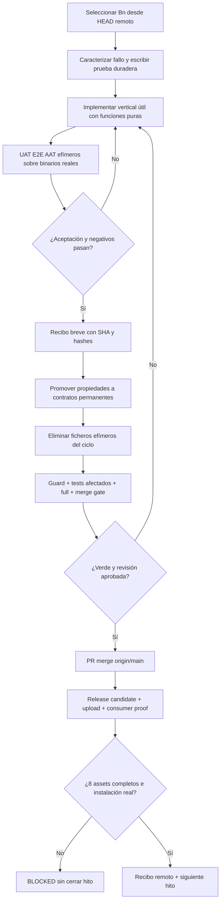

# Design VDH — decisiones, datos y efectos

**Status:** propuesta; no reescribir ADR-012/018/028 aceptados; respetar `docs/roadmap/production-ready/EXECUTION-PLAN.md` ST-03..05 y el `AGENTS.md` real.

## Functional core / imperative shell

```text
cli/mcp/http/ui (transport DTOs)
     │ parse / validate / authorize  [effectful edge]
     ▼
Application commands / injected ports / snapshot pinned
     │ input types + facts + capability availability
     ▼
Pure core: decide, normalise, analyse, aggregate, project, render DTO
     │ Outcome<Value, DomainError> (Complete|Partial|Unavailable|Failed)
     ▼
Adapters: GraphQueryPort / QualityStore / Ladybug / Parser / Filesystem
     │ explicit Result, no silent empty
     ▼
Composition root (runtime): wiring real per capability; revision/ownership
```

Rust no es un lenguaje que pruebe pureza formal como Haskell: pureza por contrato y revisión. `Result`, `Option`, newtypes y enums exhaustivos ayudan, pero `Fn` permite efectos; funciones del core no reciben file handles, HTTP clients, `Arc<Mutex<_>>` ni reloj implícito. Inyectar datos o `Clock` cuando sea imprescindible. Evitar `panic!` en camino de usuario.

## Ontología de verdad / autoridad

- `Observed<T>`: datos que se han leído con autoridad y base (workspace, revision, config digest cuando aplica).
- `Complete(T, Basis)` requiere pruebas de que se ejecutó la operación; `Complete(empty)` es legal **solo** si la fuente fue consultada y no hay elementos.
- `Partial(T, Basis, Missing)` requiere lista/causa de partes faltantes, no un número inventado.
- `Unavailable(Reason)` sin dato; `Failed(Error)` cuando se intentó consultar y falló. `Unsupported` es subclase de `Unavailable`, no éxito.
- `ExecutionReceipt` separa fuente, comando y test de producto; nunca se calcula porcentaje de cobertura a partir de counts de paths no ejecutados.
- Para UI `UnknownKind` debe mantenerse desconocido (aunque CSS use estilo neutral). No etiquetar como `function`.

## Pure functions: ejemplos

1. `parse_query(input) -> Result<QueryAst, ParseError>` (sin I/O).
2. `compile_query(ast, capabilities) -> Result<ExecutionPlan, UnsupportedReason>` (sin DB).
3. `apply_graph_algorithm(plan, GraphSnapshot) -> AnalysisOutcome<Rows, DomainError>` (snapshot ya materializado).
4. `map_analysis_outcome(outcome, project) -> Outcome<U,E>` (catamorfismo; preserva fallos/cobertura).
5. `classify_quality(issues, policy) -> QualityVerdict` (puro); `read_quality(store)` vive en edge y jamás sustituye `Err` por `[]`.
6. `decide_select_suites(ChangeSet, DependencyGraph, CapabilityMatrix) -> Selection` (puro; unknown => safe fallback) y adaptador que ejecuta comandos desde el plan.
7. `expected_assets(ReleaseContract, Platform) -> Set<AssetName>` (puro); `fetch_release_assets` (efecto); `diff_expected_actual` (puro y fail-closed).

## Data ownership, tests y source of truth

- `docs/roadmap/ROADMAP.md`: la **única** agenda. VDH es un addendum con ID, dependencias y recibos.
- `crates/cognicode-core/src/domain/...`: ADTs/leyes de dominio sin import de infraestructura.
- `application`: use cases compuestos sobre puertos estrechos; no concretos `PetGraphStore`, `InputValidator`, `TreeSitterParser`.
- `runtime`: composition root, única construcción de `LadybugStore` y capacidad del proceso.
- `interface`: DTOs MCP/HTTP/CLI versionados, mapping hacia/desde ADT.
- `test-harness`: catálogo/selector/fixtures temporales/recibos; pruebas productivas siguen en `crates/*/tests`, `apps/explorer-ui/...`, `sandbox/...` para integración con tooling.
- Efímeros deben vivir en `test-harness/.cycles` (ignorado local) y, cuando Cargo exija tests en crate, bajo nombre `__vdh_cycle_<id>_*.rs`; no mergear esos ficheros. Guard fail-closed y pruebas negativas.

## Protocolo de aceptación por release



## Compatibilidad con precedentes

- ADR-012: disponibilidad visible no se acredita con MSW exclusivamente.
- ADR-018: `foundation` no implica `integrated`; notas PostgreSQL de 2026-07 no prevalecen ante migración canónica Ladybug ADR-026/028.
- ADR-028: puertos existentes primero; no duplicar `GraphStore`/`EvidenceStore`.
- PRF-MCP-01/02/04/07: binario real, stdout puro JSON-RPC, errores y compatibilidad.
- PRF-CI-01/03/05/07: evidencia por SHA y negativos de test/publish; las efímeras no sustituyen la regresión obligatoria.
