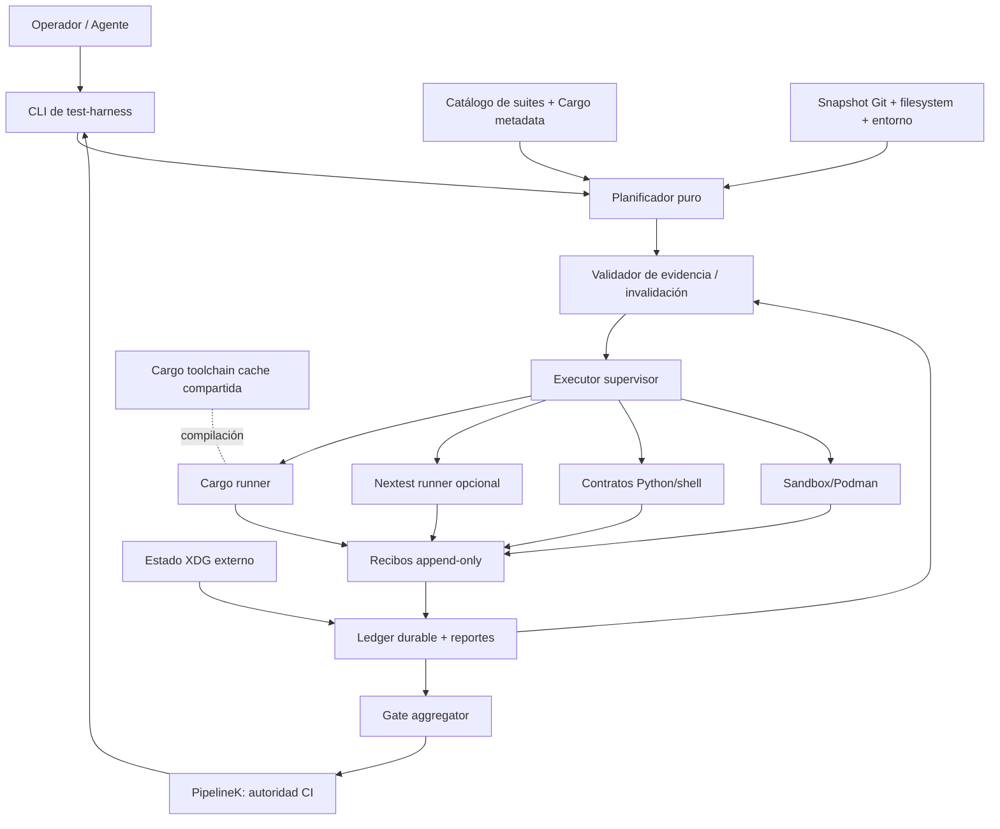

# Arquitectura destino: un subárbol, un gobierno, múltiples runners

## Distribución física deseada

```text
CogniCode/
├── test-harness/                  # NUEVO — único propietario del harness
│   ├── README.md
│   ├── docs/ adrs/ specs/ roadmap/ uat/ aat/ prompts/
│   ├── contracts/                 # schemas + catálogo generado/verificado
│   ├── bin/                       # CLI de orquestación de pruebas, sin CI paralelo
│   ├── src/                       # core puro, selección e invalidación
│   ├── adapters/                  # cargo / nextest / shell / podman / pipelinek
│   ├── tests/                     # tests del harness (incluye mutaciones)
│   ├── fixtures/                  # sólo las propias del harness
│   └── pipelines/                 # definición futura de lanes de prueba, opt-in
├── crates/                        # Rust tests donde Cargo los descubre
├── sandbox/                       # legado y repos/fixtures, temporalmente
├── scripts/                       # wrappers compatibilidad (mínimos y delegados)
├── merge-gate.pipeline.kts        # PipelineK vigente mientras dura migración
├── integration.pipeline.kts
├── certification.pipeline.kts
├── release-candidate.pipeline.kts # autoridad candidata, sin traslado indiscriminado
└── release.pipeline.kts           # publicador, NO es un test harness
```

**Importante:** el subárbol contiene el *sistema de ejecución de pruebas*, NO mueve tests unitarios/integración a un directorio que Cargo no descubre. El test code sigue cerca del crate. La migración física de pipelines de prueba no es condición de entrada: los contratos existentes nombran archivos raíz; usar wrappers o fases coordinadas, no un *big bang*. La pipeline publicadora queda deliberadamente fuera del harness por separación de responsabilidad.

## Módulos lógicos (puertos y adaptadores)



## Responsabilidades que no se duplican

- **Selector**: desde rutas y dependencias decide el mínimo conservador; no ejecuta.
- **Fingerprint**: identifica clausura concreta de entradas y entorno, no supone equivalencias.
- **Validator**: decide `Reusable/Invalidated/NotReusable` con razones tipadas.
- **Scheduler**: ordena suite DAG, aplica locks, anota los no ejecutados; no redefine PASS.
- **Adapter**: ejecuta comando existente y emite resultado normalizado; salida ajena no otorga autoridad.
- **Ledger**: conserva recibos de ejecución inmutables, sin reescribir historia.
- **Gate aggregator**: sólo declara *satisfied* si toda obligación tiene evidencia verde y válida.
- **PipelineK**: autoridad única de gate de merge, integration, certification, release; no second CI en Python.

## Forma técnica preferida

Lógica pura estilo funcional (ficheros pequeños, ADTs, funciones totales):

- `derive_suite_requirements(change_set, dependency_graph, policy) -> Requirements | Unknown`;
- `fingerprint(inputs) -> Digest | Unavailable`;
- `evaluate_reuse(receipt, snapshot, policy) -> ReuseDecision`;
- `plan(requirements, receipts, snapshot) -> ExecutionPlan`;
- `aggregate(requirements, valid_receipts) -> GateVerdict`.

Sólo adaptadores tocan FS, Git, Cargo, procesos, logs, Podman, SQLite. No abusar de modelos OO, abstracciones o bases de datos múltiples; un ledger SQLite externo opcional o JSONL append-only + índices derivados, **pero no ambos como dos fuentes de verdad**. Elegir una opción tras UAT de corte abrupto y concurrencia.

## Regla crítica: dos identidades, no una

1. `SourceSnapshot`: checkout y contenido observado (HEAD + dirty + untracked + cierres de dependencia).
2. `CandidateArtifact`: bytes publicables, SBOM, manif. y hashes verificados.

Una suite asociada al primero no acredita automáticamente el segundo. `release-candidate` y `release` mantienen sus pruebas reales sobre artefactos exactos.
